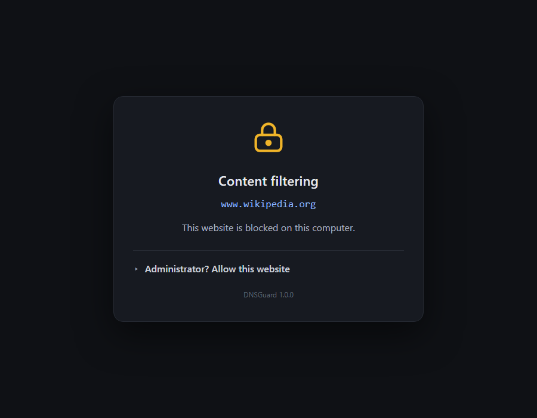

# DNSGuard

A whitelist web filter for Windows work PCs. **Every website is blocked unless it
is on the allowed list.** Blocked pages show a dark "Content filtering" page in the
browser with a password-protected *Allow this website* form. A manager window
shows all blocked traffic and lets you allow or remove websites. The same password
protects the block page, the manager and the uninstall.

Everything ships as one file: `dist\DNSGuard.exe` (run `Build-EXE.bat` to produce it).
Target PCs do not need Python.

## How it works

* **DNS filtering.** On install, every network adapter's DNS server is set to this
  computer (`127.0.0.1` / `::1`), where DNSGuard answers DNS queries:
  * Allowed names are forwarded to 1.1.1.1 / 8.8.8.8.
  * Everything else resolves to `127.0.0.1`, so the browser lands on DNSGuard's
    own web server, which serves the block page over HTTP and HTTPS.
  * Local network names (`printer.local`, single-label names, reverse lookups) are
    never filtered.
* **HTTPS without certificate warnings.** Install creates a private root
  certificate authority on that PC, puts it in the Windows trusted root store (and
  tells Firefox to use it), and mints a certificate for each blocked host on the
  fly. The CA key is readable only by administrators and is removed on uninstall.
* **Tamper resistance for standard users.** The filter runs as SYSTEM from a
  scheduled task at boot, re-applies the DNS settings every 5 minutes, disables
  browser DNS-over-HTTPS by policy (Chrome, Edge, Firefox), and keeps its
  configuration in an administrators-only folder. A standard user cannot change
  DNS, stop the task or edit the list. (A local administrator can always bypass a
  DNS filter; this tool is meant for PCs where workers are standard users.)
* **Desktop picture and start page.** At every sign-in a small task (*DNSGuard
  Logon*, runs as the signed-in user) sets the desktop picture to
  "Protected by DNSGuard" and opens Microsoft Edge at `https://vote.softgiginc.com/`.
  This works on Windows Home too. A user may change the picture; it comes back at
  the next sign-in. (The lock screen is not changed: Windows Home offers no
  supported way to set it.)
* **Live updates.** Allowing a website from the block page or the manager takes
  effect immediately; the DNS cache is flushed automatically.

## Allowed-list rules

| Entry                    | Allows                                   |
| ------------------------ | ---------------------------------------- |
| `example.com`            | `example.com` and every subdomain        |
| `sub.example.com` (exact)| only that exact host name                 |

The block page offers both choices: *Allow sub.example.com only* and
*Allow example.com (and all subdomains)*.

Out of the box the list contains only what Windows needs (updates, time sync,
certificate checks, the connectivity test) plus `softgiginc.com` and all its
subdomains, for the start page. Add your work sites after installing.

## Install

1. Copy `DNSGuard.exe` to the PC and double-click it (or run `DNSGuard.exe install`).
   Accept the Windows admin prompt.
2. Choose the DNSGuard password (6+ characters). It is stored as a salted PBKDF2
   hash, never in clear text.
3. Done. The filter is running, starts at every boot, and two Start Menu entries
   exist under **DNSGuard**: *DNSGuard Manager* and *Uninstall DNSGuard*.

Scripted install (for rolling out to several PCs, run as administrator):

    DNSGuard.exe install --password "YourPassword" --allow "work-site.com,crm.example.com" -q

## Day-to-day

* **Worker hits a blocked site** → block page. Click *Administrator? Allow this
  website*, type the password, choose exact name or whole domain. The page
  reloads on the real site. Five wrong passwords lock the form for five minutes.
* **Manager** (Start Menu → DNSGuard Manager, or `DNSGuard.exe manage`). Asks for
  the password. Tabs:
  * *Allowed websites* – add (with or without subdomains) / remove.
  * *Blocked traffic* – every blocked domain with hit count, last seen and last
    full host name. *Allow selected (domain)*, *Allow selected (exact name)*,
    *Refresh*, *Clear log*. Refreshes itself every 15 seconds.
  * *Settings* – log-only mode, change password, uninstall.
* **Pause** (top of the manager, or `DNSGuard.exe pause --minutes 30`) lets all
  traffic through for a while without uninstalling. `DNSGuard.exe resume` ends it
  early. `DNSGuard.exe status` prints the state.
* **Log-only mode** records what would be blocked but blocks nothing. Useful on a
  new PC to discover which sites the workers actually need.

## Uninstall

Start Menu → *Uninstall DNSGuard*, the *Uninstall* button in the manager, or
`DNSGuard.exe uninstall`. Requires the password. It stops the filter, restores the
previous DNS settings on every adapter (DHCP where it was DHCP), removes the
scheduled tasks, Start Menu entries, browser policies, the root certificate and all
files in `C:\ProgramData\DNSGuard`.

Emergency recovery if the password is lost: an administrator can run
`DNSGuard.exe uninstall` after stopping the task (`schtasks /End /TN DNSGuard`); or
reset DNS by hand with
`Set-DnsClientServerAddress -InterfaceIndex <n> -ResetServerAddresses`.

## Files

| Path                                        | Purpose                                      |
| ------------------------------------------- | -------------------------------------------- |
| `C:\ProgramData\DNSGuard\DNSGuard.exe`      | installed copy used by the task and shortcuts |
| `C:\ProgramData\DNSGuard\blocked.log`       | tab-separated `time  name  qtype`, trimmed at 2 MB |
| `C:\ProgramData\DNSGuard\dnsguard.err`      | exceptions and notices                        |
| `C:\ProgramData\DNSGuard\wallpaper.jpg`     | the desktop picture                           |
| `C:\ProgramData\DNSGuard\ca.crt`            | the local root certificate (public part)      |
| `C:\ProgramData\DNSGuard\private\`          | admin-only: `config.json`, `ca.key`, DNS snapshot |

## Commands

    DNSGuard.exe                 install if not installed, otherwise open the manager
    DNSGuard.exe install [--password P] [--allow a.com,b.org] [--log-only]
    DNSGuard.exe manage
    DNSGuard.exe uninstall [--password P]
    DNSGuard.exe pause [--minutes N] [--password P]     N=0: until resumed
    DNSGuard.exe resume [--password P]
    DNSGuard.exe status
    DNSGuard.exe allow <domain> [--exact] [--password P]
    DNSGuard.exe start
    DNSGuard.exe logon [--no-browser]   set the desktop picture and open the start page
    DNSGuard.exe run             the service itself (used by the scheduled task)
    -q / --quiet                 no message boxes (scripts)

## Building from source

Requires Python 3.12 on the build machine only.

    Build-EXE.bat                → dist\DNSGuard.exe

The desktop picture is `assets/wallpaper.jpg`, rendered from `assets/wallpaper.html`
(`node tools/render_wallpaper.js`, needs Playwright) and bundled into the exe.

Dependencies: `dnslib`, `cryptography` (runtime) and `pyinstaller` (build). Tk is
part of the standard Python install.

## Testing

    python -m unittest discover -s tests     unit tests (DNS decisions, matching, hashing, log parsing)
    python tests\sandbox_test.py             full end-to-end run on high ports, no admin needed

The sandbox test starts the service with `DNSGUARD_DATA` pointing at a scratch
folder and ports 15353/18080/18443, then exercises DNS over UDP and TCP, the HTTPS
block page with the generated CA, the allow flow, the API, rate limiting and live
config reload. It never touches the machine's DNS settings.

## Limitations

* DNS filtering blocks by host name. A site reached by raw IP address, a VPN, or a
  browser with its own DNS-over-HTTPS that ignores policy is not filtered.
* Local administrators can disable the filter. Make workers standard users.
* Apps that are not browsers (e.g. a chat client) simply fail to connect to blocked
  hosts; the attempt appears in the manager's *Blocked traffic* tab.
