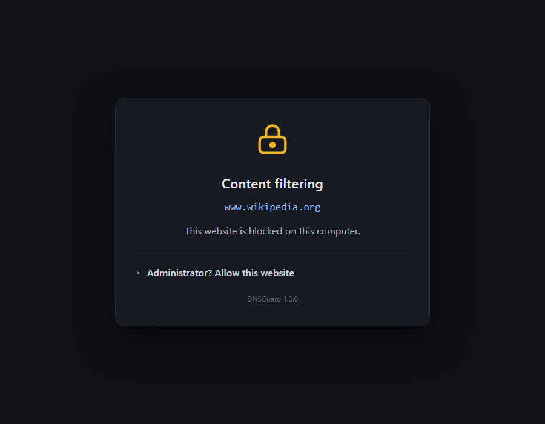

# DNSGuard

A whitelist web filter for Windows work PCs. **Every website is blocked unless it
is on the allowed list.** Blocked pages show a dark "Content filtering" page in the
browser with a password-protected *Allow this website* form. A manager window
shows all blocked traffic and lets you allow or remove websites. The same password
protects the block page, the manager and the uninstall.

Everything ships as one file: `dist\DNSGuard.exe` (run `Build-EXE.bat` to produce it).
Target PCs do not need Python.

## How it works

* **DNS filtering.** On install, every network adapter's DNS server is set to this
  computer (`127.0.0.1` / `::1`), where DNSGuard answers DNS queries:
  * Allowed names are forwarded to 1.1.1.1 / 8.8.8.8.
  * Everything else resolves to `127.0.0.1`, so the browser lands on DNSGuard's
    own web server, which serves the block page over HTTP and HTTPS.
  * Local network names (`printer.local`, single-label names, reverse lookups) are
    never filtered.
* **HTTPS without certificate warnings.** Install creates a private root
  certificate authority on that PC, puts it in the Windows trusted root store (and
  tells Firefox to use it), and mints a certificate for each blocked host on the
  fly. The CA key is readable only by administrators and is removed on uninstall.
* **Tamper resistance for standard users.** The filter runs as SYSTEM from a
  scheduled task at boot, re-applies the DNS settings every 5 minutes, disables
  browser DNS-over-HTTPS by policy (Chrome, Edge, Firefox), and keeps its
  configuration in an administrators-only folder. A standard user cannot change
  DNS, stop the task or edit the list. (A local administrator can always bypass a
  DNS filter; this tool is meant for PCs where workers are standard users.)
* **Live updates.** Allowing a website from the block page or the manager takes
  effect immediately; the DNS cache is flushed automatically.

## Allowed-list rules

| Entry                    | Allows                                   |
| ------------------------ | ---------------------------------------- |
| `example.com`            | `example.com` and every subdomain        |
| `sub.example.com` (exact)| only that exact host name                 |

The block page offers both choices: *Allow sub.example.com only* and
*Allow example.com (and all subdomains)*.

Out of the box the list contains only what Windows needs (updates, time sync,
certificate checks, the connectivity test). Add your work sites after installing.

## Install

1. Copy `DNSGuard.exe` to the PC and double-click it (or run `DNSGuard.exe install`).
   Accept the Windows admin prompt.
2. Choose the DNSGuard password (6+ characters). It is stored as a salted PBKDF2
   hash, never in clear text.
3. Done. The filter is running, starts at every boot, and two Start Menu entries
   exist under **DNSGuard**: *DNSGuard Manager* and *Uninstall DNSGuard*.

Scripted install (for rolling out to several PCs, run as administrator):

    DNSGuard.exe install --password "YourPassword" --allow "work-site.com,crm.example.com" -q

## Day-to-day

* **Worker hits a blocked site** → block page. Click *Administrator? Allow this
  website*, type the password, choose exact name or whole domain. The page
  reloads on the real site. Five wrong passwords lock the form for five minutes.
* **Manager** (Start Menu → DNSGuard Manager, or `DNSGuard.exe manage`). Asks for
  the password. Tabs:
  * *Allowed websites* – add (with or without subdomains) / remove.
  * *Blocked traffic* – every blocked domain with hit count, last seen and last
    full host name. *Allow selected (domain)*, *Allow selected (exact name)*,
    *Refresh*, *Clear log*. Refreshes itself every 15 seconds.
  * *Settings* – log-only mode, change password, uninstall.
* **Pause** (top of the manager, or `DNSGuard.exe pause --minutes 30`) lets all
  traffic through for a while without uninstalling. `DNSGuard.exe resume` ends it
  early. `DNSGuard.exe status` prints the state.
* **Log-only mode** records what would be blocked but blocks nothing. Useful on a
  new PC to discover which sites the workers actually need.

## Uninstall

Start Menu → *Uninstall DNSGuard*, the *Uninstall* button in the manager, or
`DNSGuard.exe uninstall`. Requires the password. It stops the filter, restores the
previous DNS settings on every adapter (DHCP where it was DHCP), removes the
scheduled task, Start Menu entries, browser policies, the root certificate and all
files in `C:\ProgramData\DNSGuard`.

Emergency recovery if the password is lost: an administrator can run
`DNSGuard.exe uninstall` after stopping the task (`schtasks /End /TN DNSGuard`); or
reset DNS by hand with
`Set-DnsClientServerAddress -InterfaceIndex <n> -ResetServerAddresses`.

## Recovery after a broken removal

If DNSGuard is removed abnormally — most often an **antivirus quarantines
`DNSGuard.exe`** — the executable disappears but the machine's settings do not.
The adapters still point their DNS at `127.0.0.1` / `::1`, but nothing is
listening there any more, so name resolution fails and the PC looks offline. The
scheduled task, the root certificate and the browser policies are also left
behind.

`Reset-DNSGuard.bat` + `Reset-DNSGuard.ps1` (in the repo root) repair this. They
undo **every** change a normal install makes, each step guarded so one failure
never stops the rest:

1. Stop and delete the `DNSGuard` scheduled task.
2. Stop any running `DNSGuard.exe`.
3. Restore DNS on every adapter — from the saved snapshot if it still exists,
   otherwise reset any adapter still pointing at loopback back to automatic (DHCP).
4. Remove the `DNSGuard Local CA` certificate from the machine's Trusted Root store.
5. Remove the DNS-over-HTTPS policies set for Chrome, Edge and Firefox.
6. Remove the Add/Remove Programs entry, Start Menu folder and hosts-file markers.
7. Remove `C:\ProgramData\DNSGuard` and flush the DNS cache.

It needs administrator rights, is safe to run on a PC that never had DNSGuard,
and is safe to run more than once.

**On a single PC:** copy both files to the PC, right-click `Reset-DNSGuard.bat`
→ *Run as administrator* (or just double-click — it self-elevates). Then test
with `nslookup microsoft.com` and reopen the browser.

**Across many PCs (RMM / Intune / PsExec / remote PowerShell):** run the `.ps1`
directly in an already-elevated context:

    powershell -NoProfile -ExecutionPolicy Bypass -File .\Reset-DNSGuard.ps1

Add `-AllAdapters` to reset DNS on every adapter to automatic, not only the ones
still pointing at loopback (use if an adapter was manually repointed after the
breakage).

> If the snapshot folder is gone (the usual case after an AV removal), step 3
> resets the affected adapters to **DHCP**. A PC that had *static* DNS before
> DNSGuard will come back on DHCP; set its static servers again by hand.

## Keeping antivirus from quarantining DNSGuard

DNSGuard legitimately does things that behavior-based antivirus treats as
suspicious — it rewrites every adapter's DNS, installs a root certificate, runs
as SYSTEM from a boot task and answers DNS locally. On top of that the shipped
binary is an **unsigned PyInstaller `--onefile` build**, which is one of the most
common false-positive triggers there is: a single executable that unpacks itself
to `%TEMP%` at launch and has no code-signing reputation looks, to a heuristic
engine, exactly like a dropper. The fixes, strongest first:

1. **Code-sign the executable.** This is the real solution. Sign
   `dist\DNSGuard.exe` with an Authenticode certificate (`signtool sign /fd SHA256
   /tr <timestamp-url> /td SHA256 DNSGuard.exe`). A standard OV certificate helps;
   an **EV** certificate earns SmartScreen/Defender reputation almost
   immediately. A consistent signed publisher identity is what AV engines use to
   trust a program, and it also lets you write publisher-based allow rules instead
   of fragile path/hash rules.
2. **Allowlist it in the antivirus you run.** On machines you administer this is
   entirely appropriate — it is your own software. Add an exception for the
   publisher (once signed) or for `C:\ProgramData\DNSGuard\DNSGuard.exe` in your
   AV's central console (Defender, SentinelOne, CrowdStrike, Sophos, etc.) and
   push it to the fleet *before* deploying. For Microsoft Defender specifically,
   a process/path exclusion via Intune or Group Policy
   (`Add-MpPreference -ExclusionPath`) survives reinstalls.
3. **Report false positives to the vendors.** Submit the signed binary to
   Microsoft at the Security Intelligence submission portal, and to any other AV
   vendor on your fleet. Once reviewed, the detection is cleared for everyone, so
   future versions stop getting pulled.
4. **Make the build look less like a dropper.** Prefer PyInstaller `--onedir`
   over `--onefile` (no self-extraction to `%TEMP%`), do **not** enable UPX
   compression (`--noupx`), and embed a proper version resource and application
   manifest (`--version-file`). A onedir build wrapped in a signed MSI is far less
   likely to be flagged than a bare onefile EXE.

These are false-positive-reduction and allowlisting measures for software you own
and deploy on your own managed PCs — not ways to hide the tool from a user or
from security software that is supposed to catch it. If an AV keeps removing an
*unsigned* binary, treat that as expected and sign it rather than fighting the
engine.

## Files

| Path                                        | Purpose                                      |
| ------------------------------------------- | -------------------------------------------- |
| `C:\ProgramData\DNSGuard\DNSGuard.exe`      | installed copy used by the task and shortcuts |
| `C:\ProgramData\DNSGuard\blocked.log`       | tab-separated `time  name  qtype`, trimmed at 2 MB |
| `C:\ProgramData\DNSGuard\dnsguard.err`      | exceptions and notices                        |
| `C:\ProgramData\DNSGuard\ca.crt`            | the local root certificate (public part)      |
| `C:\ProgramData\DNSGuard\private\`          | admin-only: `config.json`, `ca.key`, DNS snapshot |

## Commands

    DNSGuard.exe                 install if not installed, otherwise open the manager
    DNSGuard.exe install [--password P] [--allow a.com,b.org] [--log-only]
    DNSGuard.exe manage
    DNSGuard.exe uninstall [--password P]
    DNSGuard.exe pause [--minutes N] [--password P]     N=0: until resumed
    DNSGuard.exe resume [--password P]
    DNSGuard.exe status
    DNSGuard.exe allow <domain> [--exact] [--password P]
    DNSGuard.exe start
    DNSGuard.exe run             the service itself (used by the scheduled task)
    -q / --quiet                 no message boxes (scripts)

## Building from source

Requires Python 3.12 on the build machine only.

    Build-EXE.bat                → dist\DNSGuard.exe

Dependencies: `dnslib`, `cryptography` (runtime) and `pyinstaller` (build). Tk is
part of the standard Python install.

## Testing

    python -m unittest discover -s tests     unit tests (DNS decisions, matching, hashing, log parsing)
    python tests\sandbox_test.py             full end-to-end run on high ports, no admin needed

The sandbox test starts the service with `DNSGUARD_DATA` pointing at a scratch
folder and ports 15353/18080/18443, then exercises DNS over UDP and TCP, the HTTPS
block page with the generated CA, the allow flow, the API, rate limiting and live
config reload. It never touches the machine's DNS settings.

## Limitations

* DNS filtering blocks by host name. A site reached by raw IP address, a VPN, or a
  browser with its own DNS-over-HTTPS that ignores policy is not filtered.
* Local administrators can disable the filter. Make workers standard users.
* Apps that are not browsers (e.g. a chat client) simply fail to connect to blocked
  hosts; the attempt appears in the manager's *Blocked traffic* tab.
